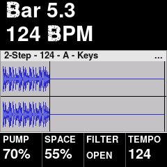

# FM-1 Again

FM-1 Again is a firmware for the M-VAVE FM-1, made for warm, emotional, rhythmic electronic music. Press PLAY and a
groove starts with chords pumping over it. Play soft electric piano, sung syllables or a chopped recording on the
keys, then press ARP to build up to the drop.

The screen is black and white with big type, set like a tour poster, and the sound is drawn as an audio editor draws
a track.

> A work in progress: this is 1.0's first sketch. Pages and sounds may still change.

---

## Contents

1. Install
2. Start in a minute
3. The screen
4. The controls
5. The pages
6. Your own samples (CHOP)
7. Saving
8. MIDI and audio
9. The screen reader
10. Credits

---

## 1. Install

Install it with fm1-base's web installer (Chrome or Edge, the FM-1 plugged in over USB), or from a terminal:

    python3 base/tools/fm1_install.py again.fwsc

The installer can put M-VAVE's own firmware back, or any other firmware. Installing is at your own risk.

## 2. Start in a minute

1. Press **PLAY**. A two-step garage groove plays at 124 BPM with chords on the keys' electric piano, ducking under
   the kick.
2. Play the keys. They play KEYS, and one key plays a whole minor-ninth chord.
3. Turn **ALGORITHM** to make the keys play VOX (sung syllables), CHOP (slices of a recording) or the DRUMS.
4. Press **ARP**. The build starts at the next bar: the snares roll faster, the sound thins out and a riser climbs.
   After four bars (or at the next bar, if you press ARP again) it drops.
5. Turn **K1** on HOME to set how hard it pumps, **K2** for the room and **K3** for a DJ filter.

## 3. The screen

- **The header.** The big first line names the page. On HOME it names the groove while stopped, and shows the bar and
  beat while playing, "Drop in 3" during a build, and "Drop!" when the drop lands. The second line shows the page's
  choice; on HOME, the chord the groove plays now (Am9, Fmaj9 ...), or the key when CHORDS is off. For a moment after
  you turn something, it shows the value you just set instead. (The tempo is TEMPO, K4 on HOME.)
- **The waveform.** It shows the last 16 bars of the sound, left channel over right: the peaks in dark blue, the
  loudness (RMS) in lighter blue, each beat ticked along the edges and each bar's tick longer. The bar at its top names the groove, the tempo, the key and what the keys play on HOME (or a tip, until you have
  done what it says); on the other pages it shows the pages of that button as tabs, the one you are on inverted. On
  CHOP's page the panel shows your sample with its slices instead.
- **The pads' strip.** The black keys' tricks, the ones playing inverted.
- **The bottom row.** The four knobs K1 to K4 on this page, each with its name and value. The one you turn is lit.

## 4. The controls

| Control | Does |
| --- | --- |
| Keys | Play what ALGORITHM chose: KEYS, VOX, CHOP, RISE or DRUMS. With velocity. The white keys play the A minor scale when KEY is A |
| Black keys | Pads: a trick while held (below). SETUP › BLACK: NOTES makes them notes again |
| OCT- / OCT+ | The keys' octave, -2 to +2 |
| PLAY | Starts and stops the groove |
| ARP | BUILD, then DROP: the build starts at the next bar and lasts BUILD bars (SETUP). ARP again during the build: the drop at the next bar. When stopped, it starts the groove too |
| HOME, SEQ, EDIT, ENV, LFO, FX, GLO | The pages (below). The same button again: its next page (SEQ: GROOVE, RISE, BUILD; ENV: VOX, CHOP; FX: SPACE, ECHO; GLO: SETUP, TAPE, MIX, MIDI) |
| SELECT | Steps through the pages |
| ALGORITHM | What the keys play |
| PRESET | The page's main choice (shown in the header's second line) |
| K1-K4 | The page's four values |
| SAVE | Saves everything (lit when something changed) |
| SEL | Tapped: says what the keys play. Held with a white key: a PERFORM trick (below) |
| REC | Looks for a Bluetooth MIDI device and connects to it. Hold it for a second to switch Bluetooth on or off |
| MASTER | The volume |

## 5. The pages

| Page (button) | PRESET | K1 | K2 | K3 | K4 |
| --- | --- | --- | --- | --- | --- |
| HOME (HOME) | the groove | PUMP depth | SPACE (the room) | FILTER: left low-pass, right high-pass | TEMPO |
| GROOVE (SEQ) | the groove | SWING | VARY: hits left out, ghosts added | KICK | HATS |
| RISE (SEQ again) | AUTO | LENGTH: 1/16 .. a bar | BRIGHT | SUCK (the noise drawn in) | AUTO: OFF, DROP, every 8 or 4 bars |
| BUILD (SEQ a third time) | STYLE | BUILD: 2, 4 or 8 bars | STYLE: SNARE, KICK, STUTTER, MIX | RUSH: the tempo climbs to + N BPM at the drop | PLAY: LOOP or SONG |
| KEYS (EDIT) | ONE KEY: the chord one key plays | TONE | DECAY | CHORDS: the groove's progression | PLAYS: HOLD, STABS, PULSE |
| VOX (ENV) | VOWELS | VOWELS | GATE | SHIFT (the voice's size) | BREATH |
| CHOP (ENV again) | REVERSE: the slice in hand backwards | SLICE | LENGTH | PITCH | MODE |
| PUMP (LFO) | SOURCE | PUMP depth | TIME (the release) | SHAPE | SOURCE: KICK, BEAT, OFF |
| SPACE (FX) | SIZE | SIZE | DAMP | SPACE (its level) | SHINE (the shimmer) |
| ECHO (FX again) | MODE: TAPE, PING-PONG, REVERSE | TIME (in steps of the tempo) | AGAIN (the repeats) | WEAR | ECHO (its level) |
| SETUP (GLO) | SAVER: the screensaver ON or OFF | KEY | BLACK: PADS or NOTES | KEYS level | VOICE level (VOX and CHOP) |
| TAPE (GLO again) | the tape: CLEAN, WARM, CASSETTE, WORN, MEMORY | WOW | WARMTH (saturation) | DULL | HISS |
| MIX (GLO a third time) | PLAY | KICK | HATS | CLAP | RISE |
| MIDI (GLO a fourth time) | SYNC | SYNC: AUTO or INTERNAL | CLOCK OUT: OFF or ON | NOTES OUT: ON or OFF | CHANNEL: OMNI or 1-16 |
| LINK (GLO a fifth time) | LINK | WI-FI: OFF, AUTO or AP | LINK: ON or OFF | TEMPO | NETMIDI: ON or OFF |

**The grooves:** HOUSE, 2-STEP, GARAGE 4X4, SHUFFLE, HALFTIME, BROKEN, MINIMAL, KICK ONLY. Each brings its own swing,
and some of their hits come only half the time or every other bar, so a groove never repeats quite the same. VARY
adds to that.

**SONG** (BUILD › PLAY): PLAY runs a whole song by itself, round and round: Intro (8 bars, the filter opening),
Groove (8), Build (4), Drop (16), Break (8, no drums), Build (4), Drop (16), Outro (8, closing). HOME names the
section and its bar.
All the drums are synthesized: a kick, a clap, a ghost snare, closed and open hats, a shaker and a rim.

**The chords (CHORDS):** LONGING, NIGHT BUS, HOPE, FLOAT and FOG, four chords of two bars each, in the KEY you set (FOG
rocks between two: the major and its relative minor, as C add9 and A minor 7 in A). OFF
leaves the keys to you.

**KEYS** is a soft FM electric piano of my own: a bark that softens as the note rings, a short tine at the start,
and a tremolo that pans.

**VOX** sings a short syllable on each key, gliding from one vowel to the next, scooped up into its pitch. Each key
has its own syllable, so a run over the keys sounds like a voice cut into pieces.

**RISE** is a reversed stab, made forwards: its pitch climbs, it swells with a suck of noise, and it stops dead.
On the keys it plays any note, and while the groove plays it ends exactly on a beat (a bar-long one on the bar). With
AUTO on DROP, the groove fires one into every drop by itself.

**ECHO's REVERSE** plays what you just played backwards, one TIME later: each note's fade becomes a swell into the
next beat.

**PUMP** is the sidechain: everything except the kick and the hats ducks under each kick (or each beat) and swells
back up.

**SPACE** is a long, smooth reverb, **ECHO** a tape echo, and **TAPE** runs the whole mix through a worn tape (wow,
warmth, a duller top and hiss). All three come from my firmware Arctic Scream, which took them from Felucca and
GR!MM.

### PERFORM: tricks on the black keys and the white

Hold a **black key**: its trick plays while you hold it, and the strip above the knobs shows it lit. From F#3 up:
ROLL 1/8 (R8), 1/16, 1/32, REVERSE, TAPE STOP, GATE, FILTER (low sweep), ECHO THROW, SPACE THROW, KICK OUT, DRUMS OUT.

Or hold **SEL** and hold a white key, for any trick (several at once). Let go and it's gone.

| White key | Trick |
| --- | --- |
| F3 | STUTTER 1/16: the last sixteenth, round and round |
| G3 | STUTTER 1/8 |
| A3 | STUTTER 1/4 |
| B3 | REVERSE: the last beat backwards |
| C4 | TAPE STOP: everything slows to a stop |
| D4 | LOW SWEEP: a low-pass closes over two seconds |
| E4 | HIGH SWEEP: a high-pass opens over two seconds |
| F4 | ECHO THROW: the keys and voices sent full into ECHO |
| G4 | SPACE THROW: the same into SPACE |
| A4 | KICK OUT: the breakdown |
| B4 | DRUMS OUT: every drum gone |
| C5 | STUTTER 1/32 |
| D5 | GATE: the sound cut to sixteenths |

The idea comes from Arctic Scream's FX performance layer; the pads on the black keys, the strip, the tabs, the
beat ticks, SONG, the builds' styles and RUSH, the step conditions and the tips come from loaf-breaker by FLEXOR
(ideas only, written anew here).

## 6. Your own samples (CHOP)

CHOP plays one recording, up to 8 seconds, cut into slices. In SLICES mode each key plays a slice; in PITCHED mode
one slice (SLICE) plays across the keys in pitch, as recorded at middle C. A slice plays while you hold its key, up to
LENGTH of it.

**REVERSE** turns a slice around: play it, then turn PRESET on CHOP's page (in PITCHED mode, the slice SLICE
chooses). It then plays from its end back to its start, swelling into its attack and stopping there. The panel marks
it with "<" before its number. Each slice has its own; a new sample starts with none.

It comes with a short phrase sung by VOX. To use your own recording (a voice, a street, a room), plug in the FM-1
and run:

    /usr/bin/python3 app/tools/again_chop.py my-voice.wav --send

The tool finds where the sound starts again and cuts it there, or into even slices with `--even 16`. The FM-1 keeps
the sample through restarts and updates. It keeps one copy: if the power goes while a sample is being sent, CHOP
plays the factory phrase until you send it again. To go back to the factory phrase:

    python3 base/tools/fm1_companion.py rm chop

### The screensaver

After a minute untouched, the screen plays a short film of a crowd at a concert, dithered black and white, round
and round, while the music plays on. The first touch only wakes the screen; it plays nothing. SETUP's PRESET turns
it off. The film comes from the USB002 tour's creative files, which its team shared with the community.

## 7. Saving

SAVE stores every value, the page, the octave and what the keys play. They come back at the next power-on, and they
stay through updates: a new version gives what it adds its default and keeps the rest.

## 8. MIDI and audio

The keys go out over USB-MIDI and Bluetooth MIDI on channel 1, and notes coming in on any channel play whatever the
keys play. Over USB the FM-1 is also an audio interface: a computer can record it and play through it.

**MIDI clock.** With SYNC on AUTO (the default), a MIDI clock that comes in (from a computer over USB, the TRS jack or
Bluetooth) leads: FM-1 Again plays at its tempo, held on its beat, and START, CONTINUE and STOP start and stop the
groove. When the clock stops coming, your own TEMPO is back. INTERNAL ignores it. CLOCK OUT sends FM-1 Again's own
tempo as a clock to the computer over USB, with START and STOP, while no clock leads.

**NOTES OUT** (on by default) sends what the groove plays as MIDI notes, over USB and Bluetooth: the drums on channel
10 (General MIDI drum notes), the chords on channel 4, RISE on channel 5; the keys stay on channel 1. STOP sends all
notes off on those channels. Turn it off when the FM-1 is only a controller.

**MIDI in.** Besides notes: pitch bend (two semitones up and down) and the mod wheel (a vibrato) bend KEYS, VOX and
CHOP; a sustain pedal (CC 64) holds what you play until it lets go; CC 7 is the volume; CC 120 and 123 let every note
go. CHANNEL takes MIDI in from one channel only (OMNI: every channel) and sends the keys on it (OMNI: channel 1).

**Ableton Link over Wi-Fi** (the LINK page). FM-1 Again plays in time with Link apps on a phone, a tablet or a
computer (Ableton Note, Live and the many apps with Link), on the same network:

- **WI-FI AP:** the FM-1 makes its own network. The page shows its name and password by turns; join it from the
  phone, and the title bar counts who joined. The simplest way, anywhere.
- **WI-FI AUTO:** the FM-1 joins a network it knows. Give it one over USB, once:
  `python3 base/tools/fm1_remote.py wifi join "NETWORK" PASSWORD`. The title bar shows its address.
- **LINK ON:** the page counts the peers in the session. With one or more (and no MIDI clock coming in, which leads
  first), the session leads: its tempo is FM-1 Again's, the groove is held on its beat, and starting or stopping in
  any app starts or stops the groove (starting, it waits for the next bar line). Turning TEMPO or pressing PLAY on the
  FM-1 does the same to the session. Alone, the FM-1 gives the session its tempo.

Link shares the tempo, the beat and start / stop, not sound or notes: each plays its own. (In Ableton Note: Link and
Start Stop Sync are in its settings, the wheel at the top right.)

**The notes to a phone: Bluetooth or Wi-Fi.** Link carries no notes; MIDI does, two ways, and you may use either or
both. What the keys play goes out (and the groove's notes with NOTES OUT on), and notes that come in play FM-1 Again.

- **Bluetooth MIDI:** in the app, connect to **FM-1 XXXX** (in Ableton Note: the wheel at the top right, Link & MIDI ›
  Input › Connect to Bluetooth, then its switch on). If notes stop arriving while the app still says Connected, tap
  the FM-1 in that list again to connect anew.
- **NETMIDI** (on by default, MIDI over Wi-Fi): with the FM-1 and the phone on the same network (WI-FI AP is simplest), the FM-1
  finds the phone's network MIDI session by itself and joins it; the page then says MIDI. In Ableton Note it is
  "Network Session 1" under Input. A computer can add the FM-1 to its network session too (192.168.4.1, port 5004,
  in WI-FI AP).

In Ableton Note the notes play the track whose instrument is open (its knobs and pads on the screen), not the Set's
overview. Note and GarageBand take MIDI in but send none out, so they cannot play the FM-1; an app with MIDI out can.

## 9. The screen reader

FM-1 Again speaks to fm1-reader, as every fm1-base firmware does: each page, value and message is said as it
changes, and a page is read whole when the reader starts listening.

## 10. Credits

FM-1 Again by PolarPatch is built on fm1-base (Charles Vestal) and felucca-bsp, from Felucca by Leo Kuroshita
(Hügelton Instruments). Its SPACE, ECHO and TAPE come from Arctic Scream, which took them from Felucca and GR!MM. The look
follows the posters of the USB002 tour, from the creative files its team shared with the community. FM-1 Again is not
made, endorsed or approved by any artist. See LICENSING.md for every part and its licence.
